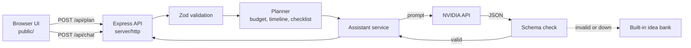

# ShubhUtsav (शुभ उत्सव): Celebration & Event Planner

A GenAI-powered planning assistant for **weddings, birthdays, community gatherings and public events** (fairs, concerts, expos, festivals). Give it your guest
count, budget, date, city and preferences. It returns a realistic budget split, a dated timeline, a vendor
checklist, festival and holiday warnings for your date and personalised ideas. It can also paint a background
for a shareable invitation card, and answers follow-up questions in a chat grounded in your plan.

Four kinds of AI and data are used:

- **Text model** (NVIDIA): ideas and chat.
- **Image model** (NVIDIA FLUX): invitation-card backgrounds.
- **Public calendar feed** (Google public India holiday calendar, no key): festivals and holidays near your date.
- **Explore events** (header button): **Calendarific** for festivals and holidays (India by default, 16 countries) and **Ticketmaster Discovery** for live concerts, sports and shows worldwide. Any result can become "Plan an event on this date".

Built for the *Celebration & Event Planner* challenge. AI is provided by an **NVIDIA-hosted model** through the
OpenAI-compatible API on [build.nvidia.com](https://build.nvidia.com).

## Chosen vertical

**Celebration & Event Planner**, aimed at Indian families, community organisers and public-event managers: amounts are in rupees,
costs vary by city tier, and food preferences include vegetarian and Jain.

## The experience

A guided, step-by-step flow, like a professional event manager's workspace:

1. **Setup wizard** (3 steps): event type and date, then guests and budget (with a live "₹8 lakh, about ₹500 per guest" hint), then food, priorities and notes. Each step is validated before you move on.
2. **Workspace** (8 steps, one panel at a time, with a progress bar and Back/Next): Overview, Budget (donut chart), Timeline, Checklist (progress ring), Dates to know, Ideas, Invitation card, Assistant.

A **light/dark switch** in the header follows your system setting until you choose, then remembers your choice on that device. The theme is applied before the page paints, so there is no flash. Printing always uses light colours.

The logo is animated (a flickering diya inside a slowly turning petal ring) and every icon is from an in-house SVG set, so nothing is loaded from outside. All motion stops when the visitor prefers reduced motion.

### Explore events

The compass button in the header opens a page with two sources:

| Tab | Source | Notes |
| --- | --- | --- |
| Festivals & holidays | Calendarific | Country, year and month. A whole year is fetched once per country and cached for a day (the free plan allows about 500 calls a month). |
| Live events | Ticketmaster Discovery | Country, city, keyword, category and a date range of up to 120 days. Cached for 10 minutes per search. Ticketmaster has limited listings in India, and the page says so. |

Both keys stay on the server. Each feature switches off cleanly (with a clear message) if its key is missing, and a provider failure shows a friendly error instead of breaking the page.

## Approach and logic

The key design decision is to **keep the numbers deterministic and let the AI do the creative part**.

| Concern | Who does it | Why |
| --- | --- | --- |
| Budget split, feasibility, timeline, checklist | Plain, tested code (`server/domain`) | Money and dates must be correct, repeatable and explainable. No hallucinated totals. |
| Themes, menu, entertainment, saving tips, chat | NVIDIA text model (`server/services`) | Open-ended, personalised suggestions. |
| Card background art | NVIDIA image model | Visual creativity. The words are drawn in the browser, because image models draw unreliable lettering. |
| Festival and holiday warnings | Public calendar feed, interpreted by plain code | Real dates, not model guesses. |
| Anything the AI returns | Validated against a strict schema | A bad or hostile answer is rejected and replaced with built-in ideas. |

### Decisions based on your context

- **Public events** get their own logic: attendance up to 50,000, no "at home" venue, a budget weighted towards entertainment, venue and logistics, and a checklist with permits, security, crowd flow, first aid, ticketing and sponsors.
- **Budget**: a contingency reserve is taken first (7%, or 10% when the event is under 30 days away). The rest is split by event-type weights, boosted for your top priorities. A home venue removes the venue line. Amounts are whole rupees and always add up exactly to your budget (largest-remainder rounding).
- **Feasibility**: spend per guest is compared with lean and comfortable benchmarks for the event type and city tier. The result is *comfortable*, *tight* or *too low*, with concrete advice such as a suggested guest count.
- **Timeline**: a template counts back from the event date. With less lead time than ideal, every step is scaled down proportionally, steps that land on the same day merge, and nothing is dated before today.
- **Checklist**: adapts to the venue (hall, outdoor, home), diet (vegetarian or Jain kitchen checks) and event type. Items whose ideal booking date has passed are marked "do this now".
- **Date insights**: festivals and holidays within a week of the date become cards and advice (festival dates are in high demand; guests travel around holidays; some dates are tentative). The feed is cached for a day, treated as untrusted text, and the plan works without it.
- **Invitation card**: the AI paints only the background (the prompt forbids text and people and leaves the centre empty); the browser draws the names, date and venue on top and exports a PNG. Without AI, a classic gradient card is used.
- **AI ideas and chat**: the prompt contains your plan facts. Your free-text notes are passed as labelled data, so instructions hidden in notes are not followed.
- **Graceful degradation**: with no API key, a timeout or a bad AI reply, the plan still works and the ideas section shows a built-in idea bank. Only the chat is disabled.

## How it works



```
server/
  index.js            start-up, graceful shutdown
  app.js              Express app: helmet, rate limits, routes, static files
  config.js           environment parsing with safe defaults
  http/               routes (api.js) and error handling (errors.js)
  domain/             pure planning logic: catalog, budget, feasibility, timeline, checklist, planner, schemas
  services/           NVIDIA client, prompts, AI orchestration with fallback
public/               accessible UI (plain HTML, CSS and ES modules, no build step)
test/                 unit and API tests (node:test)
testing/              shared test helpers
```

## Run it

Requires Node.js 20.12 or newer.

```bash
npm install
cp .env.example .env      # then add your NVIDIA_API_KEY
npm start                 # http://localhost:3000
```

Without `NVIDIA_API_KEY` the app still runs, using the built-in ideas and with the chat disabled.

| Command | What it does |
| --- | --- |
| `npm start` | Start the server |
| `npm run dev` | Start with auto-reload |
| `npm test` | Run all tests |
| `npm run lint` | Lint with ESLint |

### Configuration (`.env`)

| Variable | Default | Purpose |
| --- | --- | --- |
| `NVIDIA_API_KEY` | none | Enables AI ideas and chat |
| `NVIDIA_MODEL` | `nvidia/nemotron-3.5-bolt-e4b`, then `nvidia/nemotron-3-nano-omni-30b-a3b-reasoning` | Your preferred model id(s), comma-separated. The defaults are always appended as a fallback, so a retired model (HTTP 404/410) does not switch the AI off. Which models work depends on your NVIDIA account, so test one in the build.nvidia.com playground first. |
| `NVIDIA_IMAGE_MODEL` | `black-forest-labs/flux.2-klein-4b`, then `black-forest-labs/flux.1-dev` | Image model id(s), comma-separated. If one is retired, hangs or errors, the next is tried. |
| `NVIDIA_IMAGE_API_KEY` | falls back to `NVIDIA_API_KEY` | Separate key for images, if you have one |
| `CALENDARIFIC_API_KEY` | none | Enables the festivals list in Explore ([calendarific.com](https://calendarific.com)) |
| `TICKETMASTER_API_KEY` | none | Enables live event search in Explore ([developer.ticketmaster.com](https://developer.ticketmaster.com)) |
| `HOLIDAY_FEED_URL` | Google public India holidays | iCalendar feed; set empty to disable |
| `NVIDIA_BASE_URL` | `https://integrate.api.nvidia.com/v1` | API endpoint |
| `LLM_TIMEOUT_MS` | `20000` | Per-request AI timeout |
| `PORT` | `3000` | HTTP port |
| `APP_TIMEZONE` | `Asia/Kolkata` | Decides what "today" is for countdowns |
| `TRUST_PROXY` | `0` | Set to `1` behind one proxy (Render, Heroku) so rate limits see real IPs |
| `RATE_LIMIT_PER_MIN` / `RATE_LIMIT_AI_PER_MIN` / `RATE_LIMIT_IMAGE_PER_MIN` / `RATE_LIMIT_EXPLORE_PER_MIN` | `120` / `20` / `5` / `30` | Per-IP request limits (images are the most expensive) |

## Security

- **The API key never leaves the server.** The browser talks only to this app. Errors from the AI service are reduced to generic messages, with no key, upstream body or stack trace.
- **Strict input validation** (Zod): unknown fields are rejected, numbers and dates are range-checked, text is length-capped and stripped of control characters, request bodies are limited to 16 KB.
- **Prompt-injection resistance**: user text goes in a delimited data block, the system prompt says to ignore instructions inside it, and the AI's reply must pass a strict schema before it is used.
- **XSS-safe rendering**: the UI builds the page with `createElement` and `textContent`; there is no `innerHTML`. A strict Content-Security-Policy (`script-src 'self'`, no inline scripts or styles) is a second layer.
- **Image safety**: the image prompt is built from fixed text plus a theme reduced to plain words; the returned file is accepted only if its bytes are a real PNG, JPEG or WebP and under 6 MB, so SVG or HTML can never be passed through.
- **Explore inputs**: country must be on a fixed list, city and keyword are letters, numbers and spaces only (max 60), dates are real and capped at 120 days, and unknown parameters are rejected. Provider URLs are built with `URLSearchParams`, and API keys never appear in errors or logs.
- **External links and images**: event links must be `https`, open with `rel="noopener noreferrer"`, and images are accepted only from Ticketmaster's CDN (the only extra host in the content-security policy).
- **Third-party data**: the holiday feed is fetched from one fixed URL, size-capped, parsed strictly, stripped of control characters and rendered as text only.
- **Safe defaults for every response**: `Permissions-Policy` switches off camera, microphone, location and payments; API responses are `no-store`; POST requests must be `application/json` (415 otherwise), so another site's HTML form cannot reach the API; static files revalidate on every load.
- **Resilient AI**: model names are a list, and a retired model (HTTP 404/410) is skipped automatically, so one stale setting cannot switch the AI off.
- **Abuse limits**: per-IP rate limits, tighter on AI endpoints, plus timeouts and a single retry on the upstream call.
- **Hardening**: Helmet headers, `X-Powered-By` removed, no CORS (same-origin only), no secrets in git (`.env` is ignored), a CI audit step, and no personal data is stored or logged on the server.

## Accessibility

The step flows use the WAI-ARIA tabs pattern (arrow keys, Home and End move between steps) and mark the current step with `aria-current`. Charts always come with a table or text equivalent, so colour is never the only cue. Semantic landmarks and headings, a skip link, labelled form controls with visible focus, validation errors announced with `role="alert"`, status and chat updates in `aria-live` regions, native `progress` and table markup with captions, a 44 px minimum touch target, colour contrast designed for light and dark modes, `prefers-reduced-motion` respected, and a print stylesheet for saving the plan as PDF.

## Testing

`npm test` runs 135+ tests with Node's built-in runner:

- **Domain**: budget always sums exactly, priority and home-venue rules, timeline compression and ordering, feasibility thresholds, checklist adapting to venue and diet.
- **Validation**: ranges, past and invalid dates, unknown keys, control characters.
- **NVIDIA client**: request shape, retry only on 5xx and 429, timeouts, empty answers, key never leaked.
- **Explore**: query validation, response normalising (bad dates, `javascript:` links, foreign image hosts), caching, URL building, key never leaked, 503 without a key, 502 on provider failure, rate limit and the CSP image rule.
- **Calendar**: feed parsing (folding, escaping, tentative dates, bad entries), festival advice rules, caching, shared downloads and failure handling.
- **Image**: response parsing, file-type check, safety-block handling, key never leaked, prompt sanitising (including Hindi text).
- **AI orchestration**: valid answer used, and every failure mode (no key, error, bad JSON, wrong shape) falls back; prompt-injection text stays out of the system prompt.
- **Front-end guards**: the page has no duplicate ids (one once blanked a whole panel), every id the scripts look up exists, no inline scripts, styles or external resources, and no `innerHTML`/`eval` anywhere.
- **Public events**: attendance limits, venue rule, permits and safety tasks in the checklist.
- **API**: validation errors, oversized and malformed bodies, rate limiting, security headers, error hygiene, chat rules. No test calls the real AI service.

## Assumptions

- Costs are rough planning benchmarks for India in rupees, not vendor quotes. They are data in `server/domain/catalog.js` and easy to tune.
- "Today" is calculated in `APP_TIMEZONE` (India by default). Events can be planned up to 3 years ahead.
- Festival dates come from a public calendar and some (for example Eid) are tentative. Auspicious *muhurat* dates are not calculated; confirm them with your priest.
- Only one event is planned at a time; nothing is stored on the server. Checklist ticks are saved in the browser's local storage on that device.
- The chat is stateless on the server: the browser sends the last 12 messages with each question.

## License

GPL-3.0, see [LICENSE](LICENSE).
